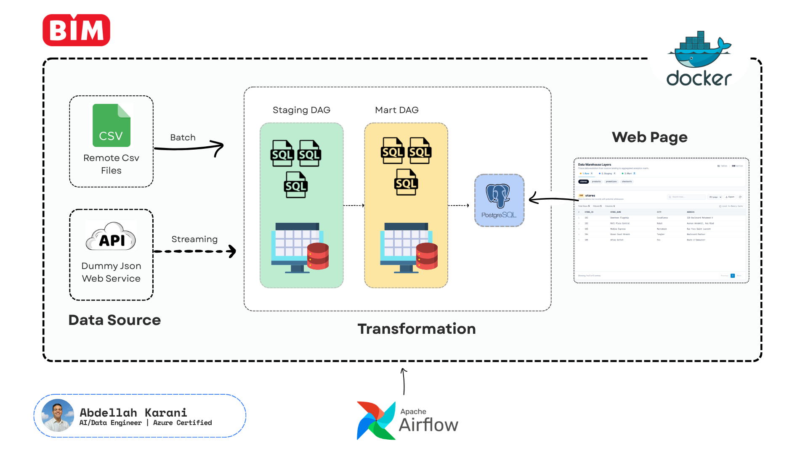
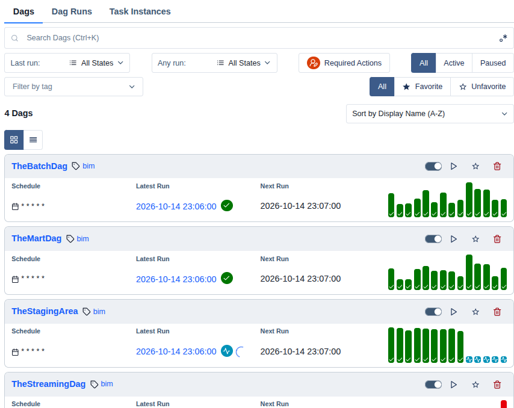
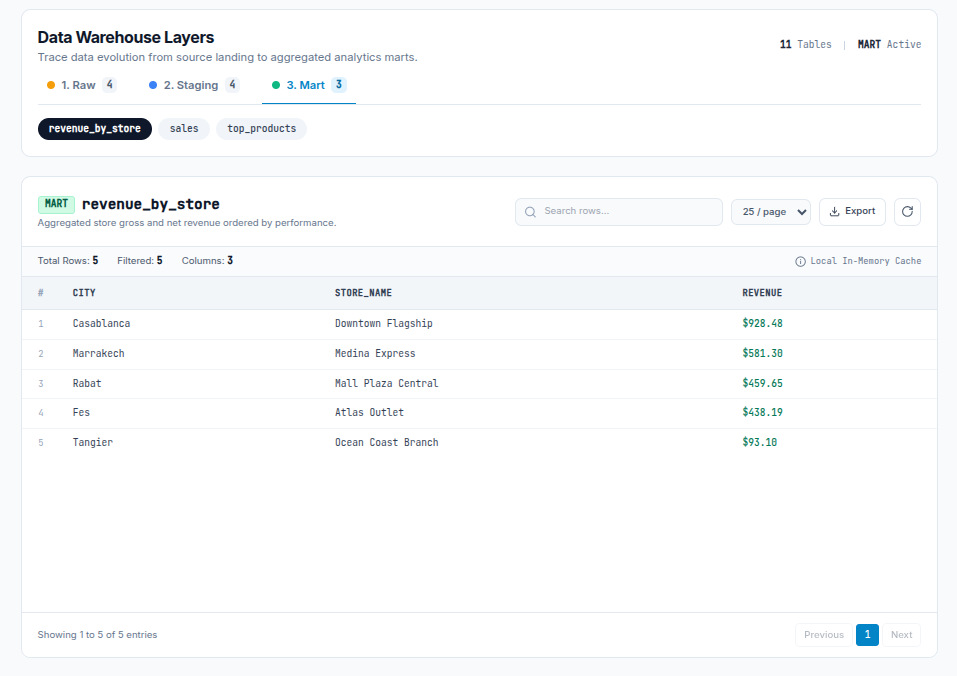

A small data pipeline built with **Apache Airflow** and **PostgreSQL**.

It collects sales data in two ways:

- **Batch:** CSV files are loaded once a day.
- **Streaming:** an API is called every minute.

The data is stored, cleaned, and turned into business tables. A simple web page then shows all the tables.

---

## Architecture



The data moves through three layers. All three layers live in the same PostgreSQL database, as three schemas.

```
 dummyjson API ──► [TheStreamingDag] ──┐
                                       ├──► RAW ──► [TheStagingArea] ──► STAGING ──► [TheMartDag] ──► MART ──► Web page
 CSV files     ──► [TheBatchDag] ──────┘
```

| Layer | Schema | What it contains |
|---|---|---|
| Raw | `raw` | Data exactly as it arrived |
| Staging | `staging` | Cleaned data (no extra spaces, no duplicates, no bad rows) |
| Mart | `mart` | Business tables, ready for analysts |

---

## The DAGs

A **DAG** is a Python file that describes a job: which tasks to run, in what order, and when. Airflow reads these files and runs them.

The project has four DAGs:



| DAG | When it runs | What it does |
|---|---|---|
| `TheBatchDag` | Every day | Reads the CSV files from the `data` folder and loads them into the `raw` tables. |
| `TheStreamingDag` | Every minute | Calls the dummyjson API and saves the checkouts into `raw.checkouts`. |
| `TheStagingArea` | Every 2 minutes | This is the **transformation layer**. It waits for the two DAGs above, then cleans the raw tables and builds the `staging` tables. |
| `TheMartDag` | After staging | Builds the business tables in the `mart` schema. |

### Why four DAGs?

The jobs run at different speeds (every minute, every 2 minutes, every day). Separate DAGs let each job have its own schedule. If something fails, you can see exactly which DAG broke.

### Order of the work

1. `TheBatchDag` and `TheStreamingDag` fill the `raw` tables.
2. `TheStagingArea` checks that both DAGs have worked, then runs one SQL file per table to build the `staging` tables.
3. When staging finishes, `TheMartDag` runs and builds the `mart` tables.

If a staging task fails, the mart is not built. This protects the mart from bad data.

---

## What each layer does

**Raw.** Data is saved without any change. It is a safe copy: if the cleaning has a bug, you can run it again from raw.

**Staging.** SQL reads each raw table and saves a cleaned copy:
- trims extra spaces from text,
- removes duplicate rows,
- removes rows with quantity 0.

**Mart.** SQL joins the staging tables and calculates business results, for example the final price after the discount.

All the steps after loading happen inside PostgreSQL, with SQL.

---

## The web page

All tables (raw, staging, and mart) can be seen in a simple web page:



- The **Tables** tab lists every schema and table. Click a table to see its rows. The mart tables are listed first.
- The **Pipelines** tab shows the flow from sources to mart, with the DAG names and the number of rows in each table.

A browser cannot connect to PostgreSQL directly. So the page talks to a small Python API (`app.py`), and the API reads the database. The API is read-only: it cannot change your data.

---

## Project structure

```
dags/          the Airflow DAGs
sql/staging/   SQL files that build the staging tables
sql/mart/      SQL files that build the mart tables
data/          the CSV files (batch source)
images/        pictures used in this README
db.py          the database connection
app.py         the API for the web page
index.html     the web page (HTML, CSS, and JavaScript in one file)
requirements.txt
```

---

## Setup

### 1. Database

Open a terminal and connect to PostgreSQL with your server username and password:

```bash
psql -h 127.0.0.1 -p 5432 -U postgres -d postgres
```

Create the database and the three schemas:

```sql
CREATE DATABASE "Ecommerce";
\c "Ecommerce"

CREATE SCHEMA raw;
CREATE SCHEMA staging;
CREATE SCHEMA mart;
```

Then create the empty `raw` tables (the script with the `CREATE TABLE raw...` statements).

Notes:
- Keep the **quotes** around `"Ecommerce"`. Without quotes, PostgreSQL turns the name into lowercase (`ecommerce`), and the connection in `db.py` (`dbname="Ecommerce"`) will fail.
- To see which database you are in: `SELECT current_database();`
- The `staging` and `mart` tables are created by the DAGs, so you do not create them by hand.

### 2. Airflow

Install Airflow with `uv`:

```bash
uv tool install "apache-airflow==3.3.2"
```

Tell Airflow where the DAG files are. Add this line to `~/.bashrc`, then reload it:

```bash
export AIRFLOW__CORE__DAGS_FOLDER="$HOME/Documents/git_projects/DummyJson_Pipelins/dags"
source ~/.bashrc
```

Start Airflow:

```bash
airflow standalone
```

Open the address shown in the terminal (usually http://localhost:8080). The login and the password are printed in the terminal the first time.

When you need a new Python package, add it to `requirements.txt` and run:

```bash
uv tool install --force --with-requirements requirements.txt "apache-airflow==3.3.2"
```

### 3. The web page

Install the two packages the API needs:

```bash
pip install flask psycopg2-binary
```

Start the API from the project folder:

```bash
python app.py
```

Open http://localhost:5000 in your browser.

> Do not open `index.html` with Live Server or by double-clicking it. The page needs the API, and the API serves the page itself.

---

## Troubleshooting

| Problem | Fix |
|---|---|
| Airflow does not show the DAGs | Check `AIRFLOW__CORE__DAGS_FOLDER` (`echo $AIRFLOW__CORE__DAGS_FOLDER`), then wait about 30 seconds and refresh. |
| `database "Ecommerce" does not exist` | The database was created without quotes. Create it again with `CREATE DATABASE "Ecommerce";`. |
| `schema "raw" does not exist` | Create the three schemas (step 1). |
| The web page says "Database error" | Check that PostgreSQL is running and that `db.py` has the right password. The API log shows the real error. |
| A table shows "missing" in the Pipelines tab | The DAG that builds it has not run yet. Run it once in Airflow. |
| The staging DAG is skipped | The batch or streaming DAG has not succeeded yet. Run it once, and the next staging run will work. |

---

## Good to know

- `db.py` has the database password written in the code. This is fine on your own computer. For a shared or real project, read the password from an environment variable instead.
- Every SQL job rebuilds its table (`DROP TABLE` and `CREATE TABLE AS`), so running a DAG again never creates duplicates.
